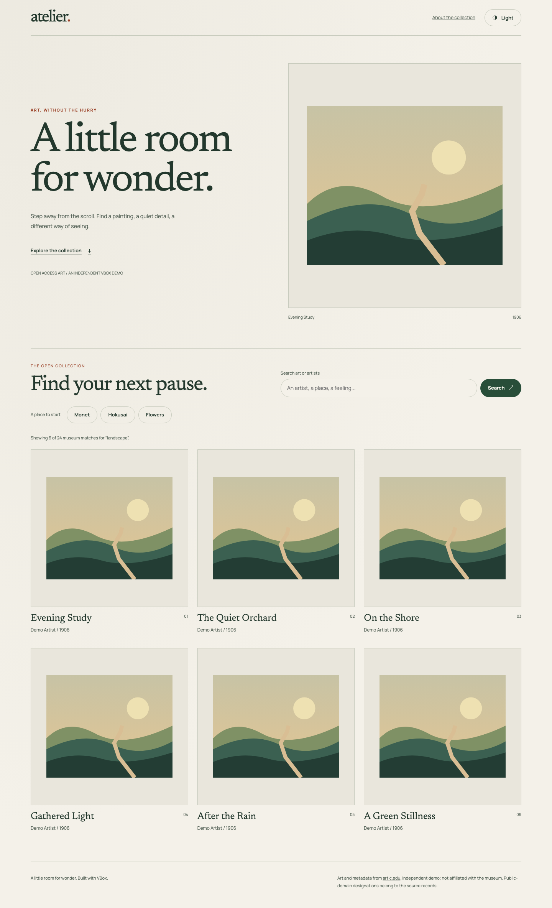
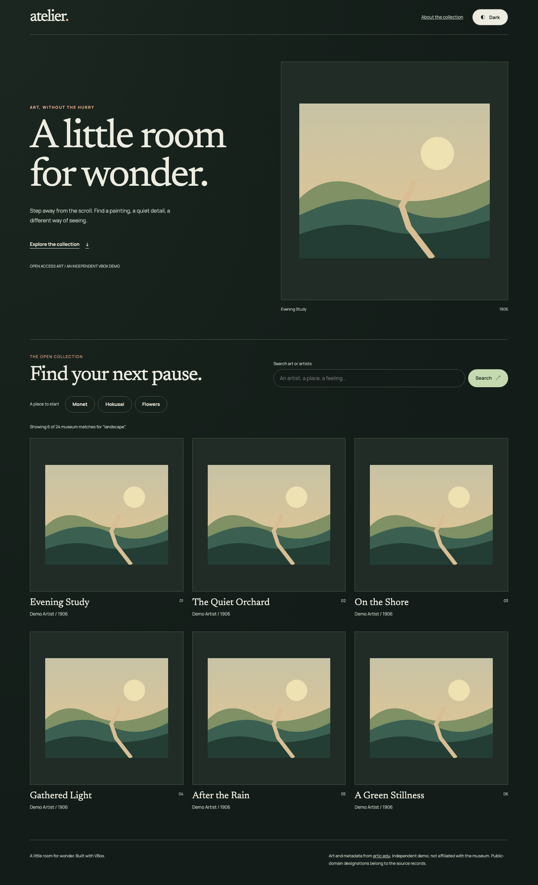
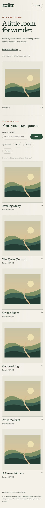
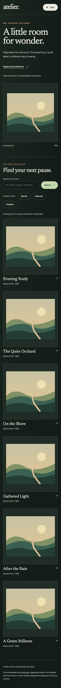

# Atelier implementation evidence

Issue #27 (slice 22/27), following the delegated
[showcase brief](../../showcases/atelier-brief.md). SpaceHub remains intact;
replacement acceptance and retirement are a separate slice and PR.

## Reproduce

```sh
pnpm --filter @vbox/atelier test
pnpm --filter @vbox/atelier type-check
ATELIER_EVIDENCE_DIR=/tmp/atelier-evidence pnpm --filter @vbox/acceptance test:atelier
```

The browser command runs the real webpack development server, builds production
output, then runs the same cases against the local production preview. The app
uses workspace VBox packages, not a Vite production adapter. Vitest uses Vue's
compiler plus the shared VBox transform for its component consumer test.

## Red/green evidence

- API adapter: an initially unimplemented search failed the query/metadata test.
  Public-domain filtering, malformed metadata, HTTP failures, cancellation and
  the 12-result cap were added in subsequent failing-test/implementation pairs.
- A failed stale-query refresh initially removed usable cached results. The
  browser regression now requires retained artwork cards plus an honest retry.
- Long, unbroken external titles initially overflowed the page and then the
  WebKit dialog. Wrapping and zero-minimum grid tracks fix the observed layouts.
- WebKit initially tabbed outside the dialog after skipping its links. Explicit
  link tab stops preserve the focus cycle; Escape restores the initiating card.

Browser coverage includes submitted search and detail metadata, empty/reset,
loading and obsolete requests, retry, missing/withdrawn images, external text
safety, both themes, widths 320/390/768/1440, keyboard navigation, dialog focus,
axe checks, persisted theme, reduced-motion/touch behavior, and caller style
withdrawal without losing internal hover/focus defaults. Tests assert rendered
behavior and computed CSS, not generated class identifiers.

## Recorded verification

Local run, 2026-10-19, Node 22.14.0 / local pnpm 9.9.0 (CI pins 10.14.0):

| Check                                            | Result                                                  |
| ------------------------------------------------ | ------------------------------------------------------- |
| Atelier API + compiled component tests           | 10 passed                                               |
| Atelier webpack development browser matrix       | 45 passed                                               |
| Atelier webpack production browser matrix        | 45 passed                                               |
| Full `pnpm run test --concurrency=1`             | 15/15 tasks successful, 8m13s                           |
| Browser cases across the full gate               | 878 passed; 4 intentional Movies CDP/non-Chromium skips |
| Core `tsc`, Vue/acceptance `vue-tsc`             | Passed                                                  |
| Actual editor integration suite                  | 76 passed                                               |
| Repeated WebKit pointer dismissal/scroll journey | 10/10 passed                                            |

The full gate includes package tests, Vite/webpack shared consumers, Nuxt
SSR/hydration, playground, docs, Movies, Atelier, and the retained SpaceHub unit
suite. Five build tasks used cached outputs; test tasks were executed.

Independent standards review found no actionable violations. Spec review led to
stronger asynchronous disabled-state assertions, both dialog dismissal paths,
complete results/scroll preservation, and computed theme colors with state
retention. The first strengthened scroll test exposed WebKit's `Locator.click`
auto-scrolling before the application handler, not a dialog restoration bug. A
fully visible coordinate-pointer click avoids that extra harness action; ten
repeated runs and the complete gate passed. No application scroll workaround or
relaxed scroll tolerance was added.

## Rendered examples

These are actual Chromium screenshots of the app with **controlled fixture
metadata and original synthetic illustration**, not live museum artwork or a
claim about live API availability. All external data/image requests in these
browser tests are intercepted at the HTTP boundary. The primary-source API
research and its live query probe are recorded separately in
[the data note](../../research/atelier-data.md).

| Desktop light                            | Desktop dark                           |
| ---------------------------------------- | -------------------------------------- |
|  |  |

| Mobile light                           | Mobile dark                          |
| -------------------------------------- | ------------------------------------ |
|  |  |

## Limits

Automated axe scans and keyboard tests are not a WCAG certification. Manual
screen-reader, zoom, real-device and live-artwork review remains necessary.
Public-domain designations are the museum's metadata, not a new legal warranty.
No deployment, publication or replacement of the existing showcase is performed
by this implementation. CI's timeout grows from 20 to 25 minutes to include the
additional two-build, three-engine matrix; the preceding suite took about 15
minutes on GitHub Actions.
