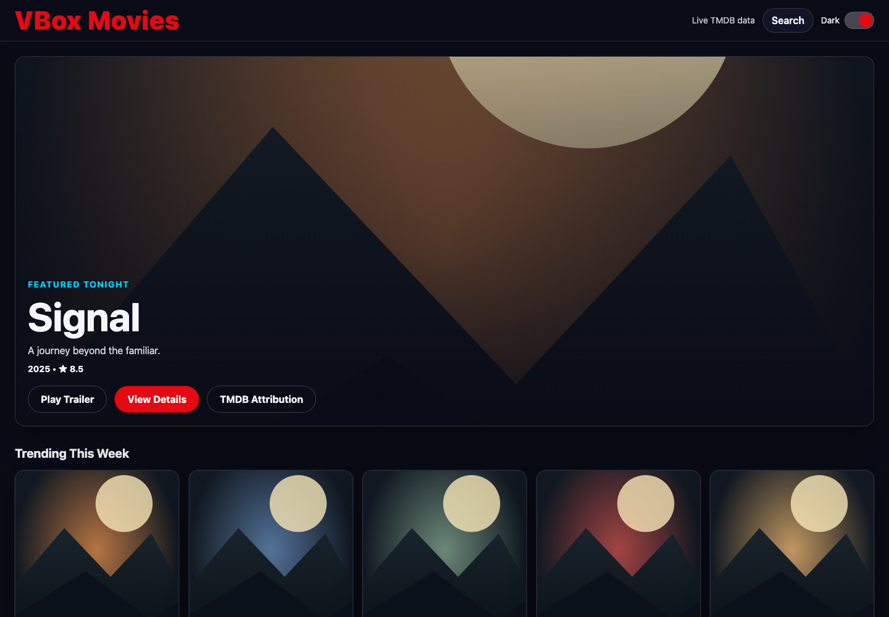
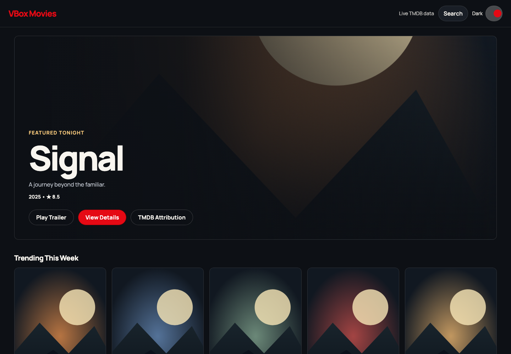
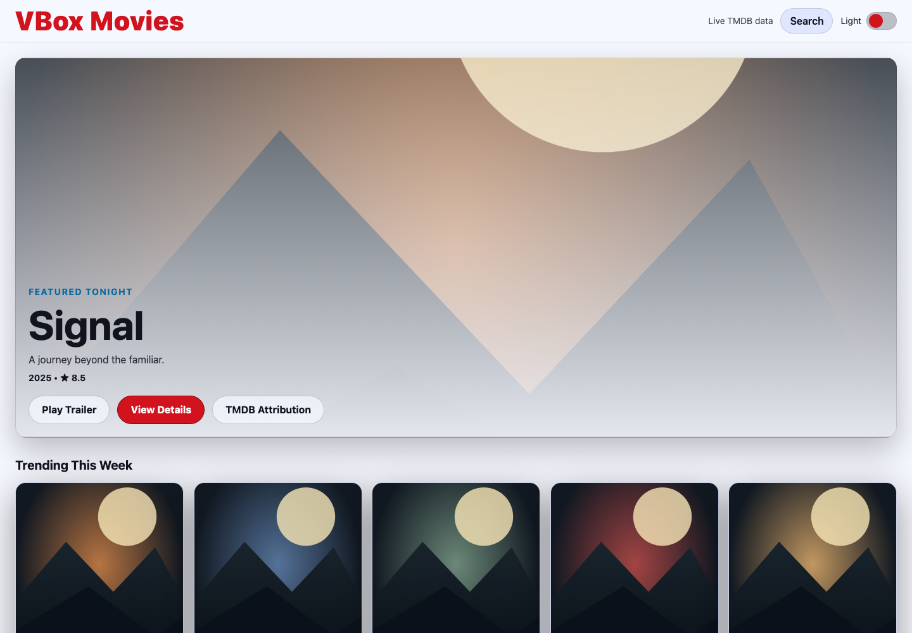
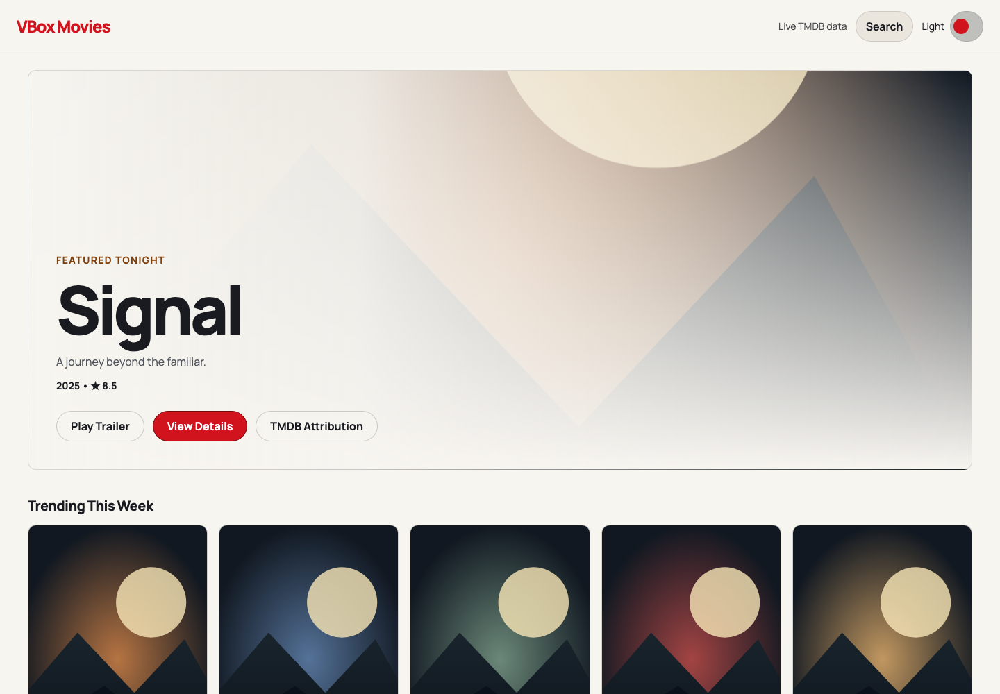
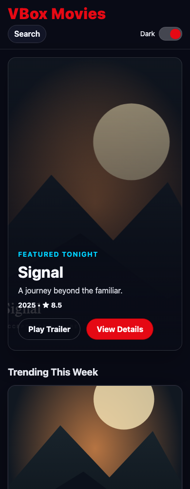
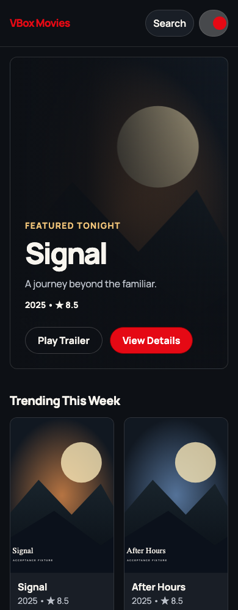
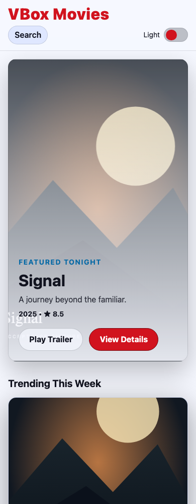
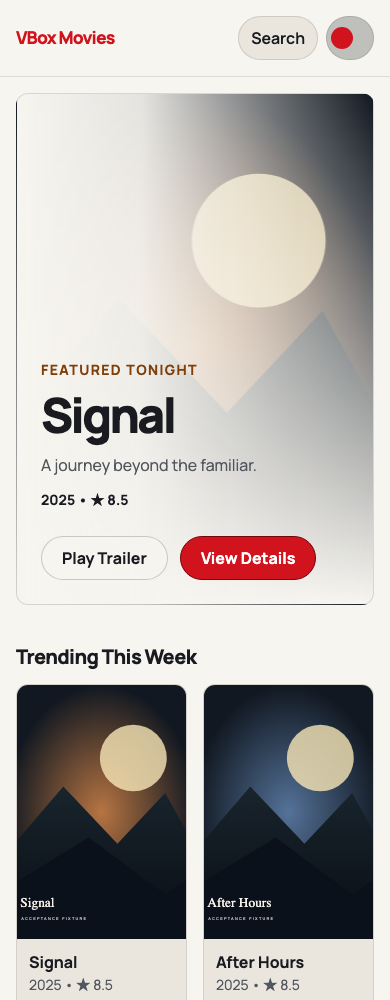

# Movies showcase polish

Slice 20/27, issue #26. Builds on the explicit styling migration in #16.

## Visual evidence

These are real Chromium captures of the Movies app at 390 x 1000 and 1440
x 1000. TMDB HTTP responses and artwork are deterministic, authored test
fixtures, **not live movie recommendations or third-party photographs**. The
before capture is slice 19; after is the polished implementation.

| Before                                         | After                                        |
| ---------------------------------------------- | -------------------------------------------- |
|    |    |
|  |  |
|      |      |
|    |    |

Retains the red cinema identity and existing navigation. Refines typography
(self-hosted Manrope), warm neutral themes, hero hierarchy,
two/three/five-column poster rows, modal sizing, touch targets, loading
skeletons and failure feedback. Layout, appearance and conditional state styling
remain VBox-authored.

## Behavior evidence

Before/after tests exercise public UI rather than generated class names:

- Reduced motion: the previous card still enlarged on hover; it now stays still.
- Keyboard navigation: the previous router guard started transitions for every
  navigation; keyboard/reduced-motion navigation now bypasses transitions.
- Keyboard entry: previously no skip link; now the first Tab reaches a skip link
  which transfers focus to the page's main landmark.
- Light-theme automated scan: the initial GSAP opacity tween produced a sampled
  1.62:1 button contrast. The hero now renders immediately, with no entrance
  tween hiding actionable content. Both themes pass the automated checks.
- Details loading: previously anonymous decorative blocks; now a named loading
  status with aria-hidden placeholders. Empty collections have visible feedback.
- Review regression: failed background collection/search refreshes retain usable
  cached results and show non-blocking feedback rather than replacing the grid.
- Collection skeletons reserve ten cards and the same metadata area as loaded
  cards. Tests hold the HTTP response and compare the next section's position at
  390/1440 px (within 1 px for a full response). Short responses and unusually
  long titles can still change the final height.
- View transitions: tests verify native readiness, an actual root opacity
  animation, successful completion and navigation in all three browsers. A
  temporary disabled-animation mutation correctly failed the stronger check.
- Cards: transform-only 180 ms hover feedback, smooth reversal, stable
  neighboring geometry, fine-pointer gating and no motion on keyboard focus.
- Existing 1500 ms debounce, search result navigation/closure, trailer iframe
  lifecycle, focus return, theme handler and production detail routes remain
  protected by the migration journey suite.

Run `pnpm --filter @vbox/acceptance test:movies` for the actual Vite development
and production builds in Chromium, Firefox and WebKit. Screenshots and full axe
reports (including incomplete checks) are test attachments. To capture the
comparison again, set `MOVIES_EVIDENCE_DIR` to an absolute output directory and
run `polish.spec.ts` with `--project=movies-chromium`.

## Motion budget

The Chromium-only CDP test records 30 animation-frame samples with 4x CPU
throttling. An isolated local run measured **16.7 ms median / 16.7 ms p95**,
with **two one-off layout passes across hover entry/exit**, rather than
per-frame layout. The test also measures the intervening frame window
separately.

Guards: transform is the only card transition property, duration is at most 250
ms, neighboring geometry is unchanged, there are at most two state-boundary
layouts and no intervening layouts. A broad p95 < 100 ms CI ceiling catches
severe regressions; it is deliberately **not** a 60/120 fps certification on
shared runners. Actual samples are attached on every run. No per-frame reactive
updates, animated shadows/filters, permanent `will-change`, or infinite
shimmers.

Use the browser's root view transition (200 ms) through Vue Router's supported
option; never derive a transition name from a movie ID because titles repeat
across rows. Unsupported browsers navigate normally. Pointer-triggered
transitions are progressive enhancement, not a navigation dependency.

WebKit regression checks also exposed Safari's default link-tabbing policy and
its lack of pointer focus on buttons. The skip link now has an explicit zero
tabindex; both dialog triggers focus themselves before Radix records the active
element. This prevents a newly focusable main landmark from accidentally
becoming the close-focus target. The same failing browser checks pass after the
fix.

## Limits and follow-up

Automated axe WCAG A/AA checks cover home, search, details and the empty trailer
dialog in both themes. These do not prove complete WCAG compliance. Manually
review screen-reader announcements, image-dependent contrast, zoom/large text,
real TMDB imagery, touch scrolling on a mid-range phone and 120 Hz rendering.
CPU-throttled desktop headless tests do not emulate a phone GPU. Third-party
video playback is not exercised; iframe URL, title and removal are.

No deployment or package publication is performed by these checks.

References:
[Playwright accessibility testing](https://playwright.dev/docs/accessibility-testing)
and
[Vue Router RouterLink source](https://github.com/vuejs/router/blob/main/packages/router/src/RouterLink.ts).
The installed Vue Router 4.6.4 implementation was also inspected.
